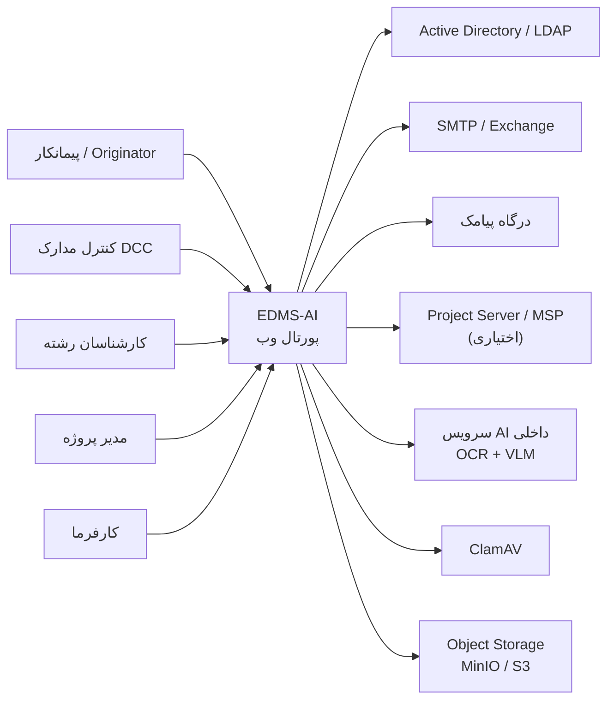
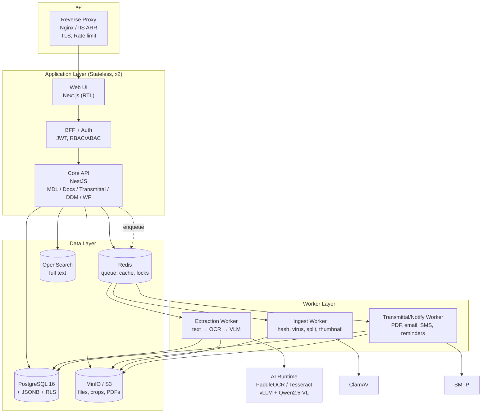
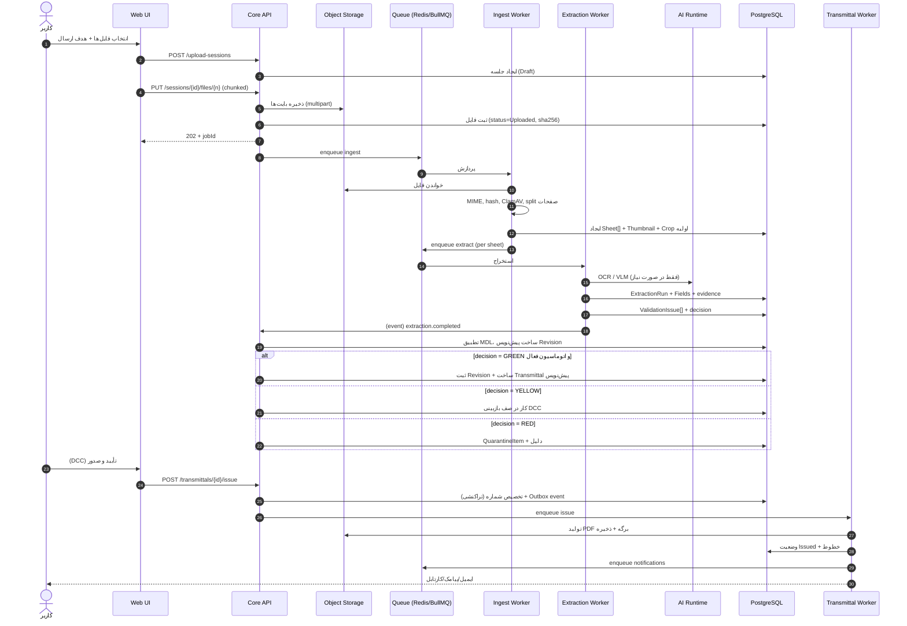
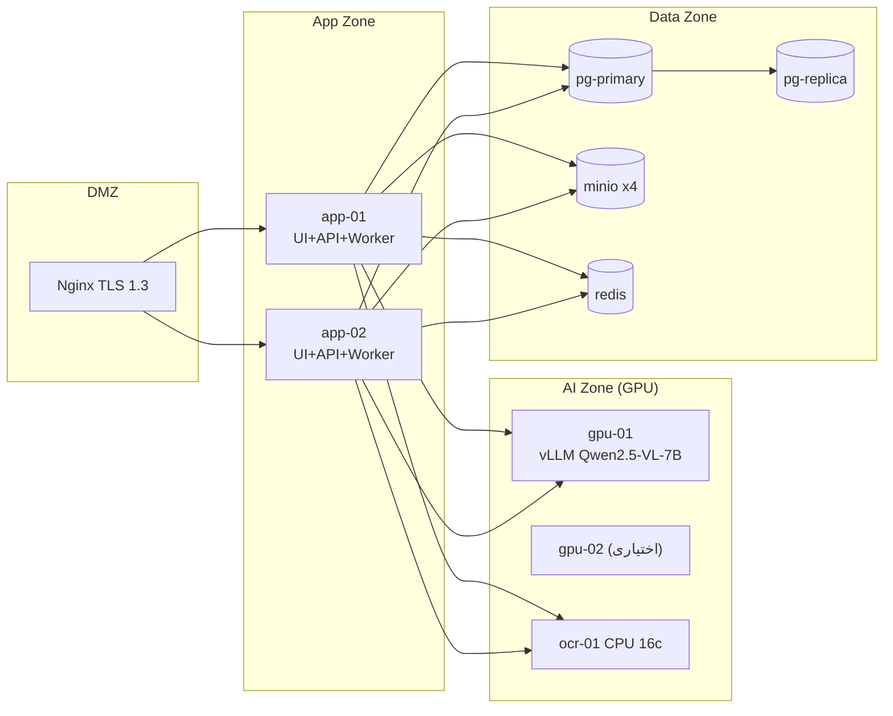

# ۰۲ — معماری سیستم

> شناسه: **EDMS-AI-ARCH-002** · مرجع نیازمندی: `01-scope-and-requirements.md`

---

## ۱. اصول حاکم بر معماری

| اصل | پیامد عملی |
|---|---|
| **تفکیک مسیر کند از سریع** | آپلود و استخراج در Worker؛ API هرگز منتظر OCR/VLM نمی‌ماند |
| **قاعده بر مدل مقدم است** | خروجی AI همیشه از فیلتر قواعد قطعی می‌گذرد (سند ۰۳) |
| **همه‌چیز قابل بازسازی** | ذخیره شواهد: متن خام، برش تصویر، bbox، نسخه مدل و پرامپت |
| **دروازه انسانی قابل حذف است، نه قابل دور زدن** | دو نقطه تأیید (DCC و صدور) با تنظیم سطح اتوماسیون |
| **مرز ماژول = مرز آینده سرویس** | ماژول‌ها با API داخلی و رویداد صحبت می‌کنند، نه با جدول یکدیگر |
| **داده پروژه ایزوله** | Row-Level Security در Postgres + Prefix در Storage |
| **Idempotency همه‌جا** | آپلود، پردازش، ارسال اعلان، صدور Transmittal |

---

## ۲. نمای زمینه (Context)



---

## ۳. معماری ظرف (Container)



### نقش هر جزء

| جزء | مسئولیت | چه چیزی **نیست** |
|---|---|---|
| `Core API` | مالک داده دامنه، قواعد کسب‌وکار، مجوزدهی، تراکنش | محل اجرای پردازش سنگین |
| `Ingest Worker` | اعتبارسنجی فایل، ویروس‌اسکن، Hash، تفکیک شیت، Thumbnail | تصمیم‌گیری درباره مدرک |
| `Extraction Worker` | اجرای خط لوله استخراج و ذخیره شواهد | ثبت Revision یا ارسال |
| `Transmittal Worker` | شماره‌گذاری، تولید PDF، اعلان، یادآور | ساخت محتوای Transmittal (این کار API است) |
| `AI Runtime` | سرویس مدل (OCR/VLM) با API داخلی | دسترسی به پایگاه داده |
| `Scheduler` | کارهای زمانی: یادآور، Escalation، پاکسازی، Snapshot KPI | — |

---

## ۴. مرزهای ماژول (Modular Monolith)

```text
src/
├─ modules/
│  ├─ project/        پروژه، دیسیپلین، Unit، تنظیمات، تقویم کاری
│  ├─ mdl/            MDL، ایمپورت، نسخه‌بندی، Alias
│  ├─ ingest/         Upload Session، فایل، شیت، ویروس‌اسکن، Hash
│  ├─ ai/             قالب Title Block، پرامپت، مدل، اجرای استخراج، شواهد
│  ├─ matching/       نرمال‌سازی، تطبیق دقیق/فازی، کاندیدها
│  ├─ validation/     کاتالوگ قواعد، موتور اجرا، امتیاز اطمینان
│  ├─ documents/      مدرک، Revision، Supersede، Timeline
│  ├─ transmittal/    گروه‌بندی، شماره‌گذاری، صدور، PDF، تأییدیه
│  ├─ ddm/            ماتریس توزیع، شبیه‌ساز
│  ├─ review/         Comment List، Annotation
│  ├─ workflow/       گردش‌کار چندسطحی، کارتابل، Delegation
│  ├─ notify/         Template، کانال‌ها، ترجیحات، Outbox
│  ├─ reporting/      KPI، گزارش‌ها، Export
│  ├─ audit/          لاگ تغییرناپذیر
│  └─ identity/       کاربر، نقش، گروه، همگام‌سازی AD
└─ shared/            خطاها، DTO، رخدادها، تاریخ شمسی، Storage client
```

**قاعده مرزی**: هر ماژول فقط از طریق `Service` عمومی خودش و رویدادهای دامنه با بیرون حرف می‌زند. دسترسی مستقیم به جدول ماژول دیگر در کد ممنوع (با ESLint rule قابل اجرا).

---

## ۵. جریان اصلی: از آپلود تا Transmittal صادرشده



### نقاط شکست و رفتار تعریف‌شده

| نقطه شکست | رفتار |
|---|---|
| قطع آپلود | Resumable؛ فایل ناقص هرگز ثبت نمی‌شود |
| فایل آلوده | جلسه ادامه می‌یابد، فایل قرنطینه و به کاربر اطلاع داده می‌شود |
| AI Runtime خاموش | Retry با Backoff؛ پس از N بار ← صف «استخراج دستی» (RED-عملیاتی، نه رد مدرک) |
| شکست تولید PDF | صدور Rollback می‌شود؛ شماره آزاد نمی‌شود (شماره مصرف‌شده باطل و ثبت می‌شود) |
| شکست ارسال ایمیل | Outbox با Retry؛ وضعیت `Notification.Failed` و نمایش در UI |
| قطع DB هنگام صدور | تراکنش واحد؛ هیچ Transmittal نیمه‌صادرشده‌ای باقی نمی‌ماند |

---

## ۶. صف، Idempotency و Outbox

**صف‌ها**: `ingest`, `extract:high`, `extract:bulk`, `transmittal`, `notify`, `report`.
- اولویت: کاربر تعاملی > دسته‌ای شبانه. سهمیه GPU با Semaphore در Redis.
- Retry: `ingest` ۳ بار، `extract` ۲ بار، `notify` ۵ بار با Backoff نمایی (۱m، ۵m، ۱۵m، ۱h، ۴h).
- Dead-letter queue با آلارم و صفحه مدیریت خطا در پنل Admin.

**Idempotency Key**:
| عملیات | کلید |
|---|---|
| پردازش فایل | `sha256(source_file)` |
| اجرای استخراج | `sha256(sheet_id + pipeline_version + template_version)` |
| ساخت Transmittal | `sha256(project + purpose + recipient_set + sorted(revision_ids))` |
| صدور | `transmittal_id` (اگر Issued باشد، دوباره اجرا نمی‌شود) |
| اعلان | `sha256(notification_type + entity_id + user_id + attempt_bucket)` |

**Outbox**: هر رخداد دامنه در همان تراکنش کسب‌وکار در `outbox_event` نوشته می‌شود؛ یک Dispatcher آن را به صف می‌برد. نتیجه: اتمیسیتی بین «تغییر داده» و «ارسال پیام».

---

## ۷. لایه ذخیره‌سازی

```text
s3://edms/{project_code}/
   incoming/{yyyy}/{mm}/{session_id}/{file_id}/original.pdf
   sheets/{sheet_id}/page-001.pdf
   thumbs/{sheet_id}/page-001.webp
   crops/{sheet_id}/titleblock.webp
   revisions/{doc_no}/{rev}/{file_id}.pdf
   transmittals/{number}/sheet.pdf
   comments/{revision_id}/annotations.json
```

**قواعد**:
- Bucket خصوصی؛ دسترسی فقط با لینک امضاشده (TTL پیش‌فرض ۱۵ دقیقه، حداکثر ۲ ساعت).
- Versioning فعال؛ حذف نرم (Soft delete) با `Object Lock` برای فایل‌های صادرشده.
- فایل اصلی هرگز بازنویسی نمی‌شود؛ هر بارگذاری، شیء جدید.
- محاسبه Hash روی **فایل ذخیره‌شده**، نه فایل کلاینت.

**پایگاه داده**: Postgres 16؛ جدول‌های حجیم (`audit_log`, `extraction_field`, `notification`) ماهانه Partition؛ ایندکس GIN روی `payload` و `pg_trgm` روی کد/عنوان مدرک.

**کش**: Redis برای تنظیمات پروژه، قالب Title Block، DDM حل‌شده، و نتیجه پرتو‌های تکراری؛ TTL ۵ دقیقه + ابطال رویدادی.

---

## ۸. پشته فنی پیشنهادی

| لایه | انتخاب | چرا / جایگزین |
|---|---|---|
| UI | **Next.js 14 + TypeScript + Tailwind + shadcn/ui** | RTL و کامپوننت‌های بالغ؛ جایگزین: React+Vite، Blazor |
| API | **NestJS (TypeScript)** | مرز ماژول، DI، اعتبارسنجی Schema؛ جایگزین: FastAPI+Django، .NET 8 |
| DB | **PostgreSQL 16** | JSONB برای payload، RLS برای ایزوله‌سازی، pg_trgm |
| Queue | **Redis 7 + BullMQ** | سبک و کافی؛ جایگزین: RabbitMQ |
| Storage | **MinIO** (یا S3/NAS) | On-prem، سازگار S3 |
| PDF | **PyMuPDF** (تحلیل)، **pdfplumber** (جدول/مختصات)، **Paged.js یا WeasyPrint** (تولید برگه) | فارسی/RTL در WeasyPrint با فونت Vazirmatn |
| OCR | **Tesseract 5 (fas+eng)** یا **PaddleOCR** | مقایسه دقت روی مجموعه طلایی |
| VLM | **Qwen2.5-VL-7B-Instruct** روی vLLM؛ گزینه ۳۲B برای دقت بالاتر | مدل باز، قابل اجرای داخلی |
| Search | **OpenSearch** (اختیاری فاز ۲) | جست‌وجوی متن کامل مدارک |
| Auth | **Keycloak** + LDAP Federation | SSO، نقش‌ها، MFA |
| Observability | **OpenTelemetry + Prometheus + Grafana + Loki** | — |

---

## ۹. استقرار (نمای فیزیکی)



- همه سرویس‌ها Stateless به‌جز داده؛ مقیاس افقی با افزودن `app-0N`.
- GPU فقط در AI Zone و بدون دسترسی به اینترنت؛ egress صفر (NFR-015).
- جداسازی شبکه: App ↔ DB فقط پورت ۵۴۳۲؛ App ↔ MinIO ۹۰۰۰؛ App ↔ GPU ۸۰۰۰ (gRPC/HTTP داخلی).

---

## ۱۰. مشاهده‌پذیری و بهره‌برداری

| متریک | آستانه هشدار |
|---|---|
| `extraction_duration_p95` | > ۹۰s |
| `queue_depth{extract}` | > ۲۰۰ |
| `ai_vlm_fallback_rate` | > ۳۵٪ (نشانه ضعف قالب/OCR) |
| `auto_accept_rate` | کاهش > ۱۰٪ هفتگی |
| `transmittal_issue_failures` | > ۰ |
| `notification_undelivered` | > ۵ در ساعت |
| `db_connections` | > ۸۰٪ سقف |

هر درخواست دارای `correlation_id` و هر کار صف دارای `job_id` قابل جست‌وجو در لاگ ساختاریافته است.

---

## ۱۱. چرا این معماری و نه چیز دیگر (خلاصه استدلال)

| گزینه | مزیت | درد | تصمیم |
|---|---|---|---|
| میکروسرویس کامل (۱۰+ سرویس) | استقلال تیم‌ها | هزینه DevOps، تراکنش توزیع‌شده، پیچیدگی برای تیم کوچک | ❌ فاز ۱ |
| مونولیت بدون Worker | سادگی | آپلود A0 + OCR، API را قفل می‌کند | ❌ |
| Serverless/Cloud AI | دقت بالا، بدون GPU | نقض محرمانگی، هزینه متغیر، وابستگی به اینترنت | ❌ پیش‌فرض |
| **مونولیت ماژولار + Worker + AI داخلی** | تعادل | نیاز به یک GPU و یک نفر DevOps | ✅ |
